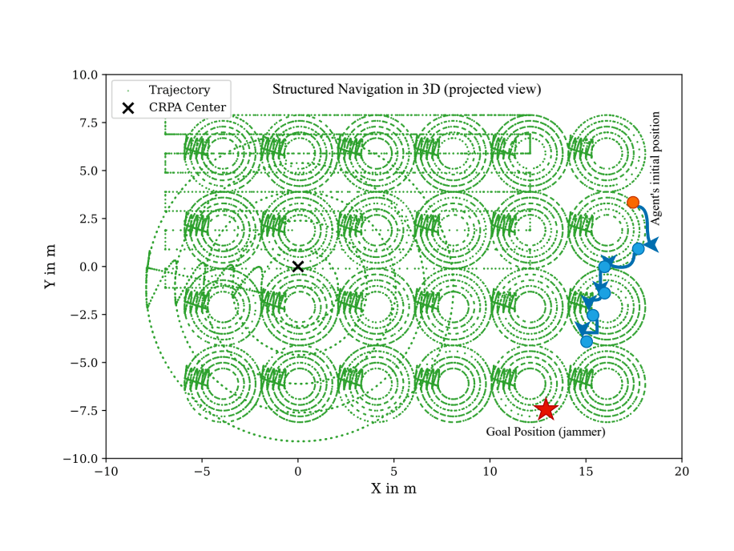
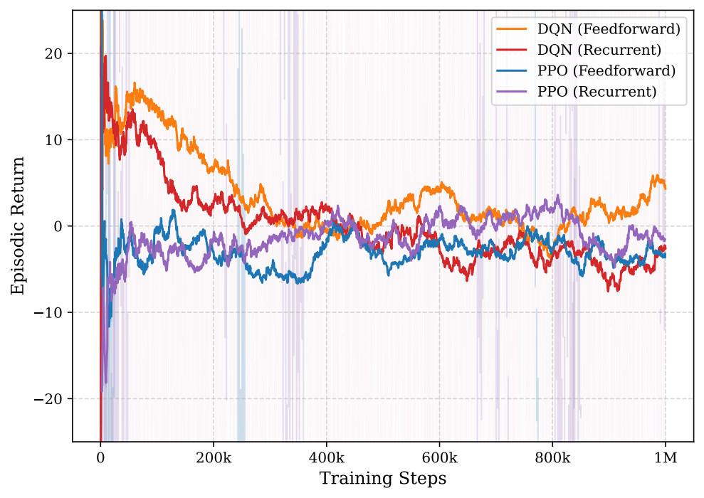

# Reinforcement Learning for Adaptive GNSS Interference Monitoring

**Master's thesis portfolio | Mohammad Shamail Jamal Khan | FAU Erlangen-Nuremberg**

Research into active GNSS interference-source localization: an agent uses RF observations to choose where to move, learns from sequential measurements, and attempts to adapt when the environment changes.

**Research period:** July 2025 - January 2026. **Thesis submitted:** January 28, 2026.

## Project at a glance

| Research question | Approach |
| --- | --- |
| How can RF observations guide active jammer localization? | Formulate navigation as a sequential decision problem with Gymnasium environments. |
| Can memory help with ambiguous measurements? | Compare feedforward DQN/PPO against recurrent policies using LSTM representations. |
| Can a policy adapt to a different environment? | Explore heads-only ANIL-style first-order MAML adaptation across wall configurations. |

**Technologies represented:** Python, PyTorch, Gymnasium, NumPy, scikit-learn, TensorBoard, and recurrent neural networks.

## Start here

- [Technical walkthrough](docs/TECHNICAL_WALKTHROUGH.md): environments, learning methods, and source entry points.
- [Reported results](docs/RESULTS.md): selected findings, including low success rates and transfer limitations.
- [Reproducibility](docs/REPRODUCIBILITY.md): missing materials and checks actually performed.
- [Repository scope](docs/PUBLICATION_NOTES.md): included materials, project history, and attribution.

## Approach

RF measurement at agent position -> IQ or spectrogram observation -> feedforward or recurrent policy -> navigation action -> environment transition and reward -> next observation.

The code retrieves RF observations from measurement-backed navigation environments for training and evaluation.

*Archived thesis illustration of Environment B; a schematic rather than a geographical location.*

## Selected evidence

*Archived experiment figure; training was not rerun for publication.*

The thesis reports modest benefits from temporal memory and environment-dependent adaptation. Successful localization remained rare. On held-out wall configurations, reported success rates ranged from 0% to 7% across the compared methods and checkpoints. These exploratory results do not establish deployment readiness. See [results and context](docs/RESULTS.md).

## Source map

| Location | Contents |
| --- | --- |
| src/agents/ | Eight archived DQN, PPO, recurrent, and first-order meta-learning scripts |
| src/classes/ | Two environments, two registration modules, and two CNN models |
| assets/ | Four rendered thesis experiment figures |
| environment.yml | Archived Linux Conda environment specification |
| docs/ | Methods, reported results, reproducibility, and provenance |

## Running and validation

The repository includes research source and reported thesis results. Running the training scripts requires authorized RF data, the original dataset loader, missing package modules, and restored imports. The archived Linux environment specification has not been installed or validated for this release.

All 14 published Python files passed syntax parsing during preparation. This does not establish runtime correctness: no training, inference, or result reproduction was performed. Read the [reproducibility notes](docs/REPRODUCIBILITY.md) before attempting execution.

## History and attribution

This repository collects source code and selected results from the completed thesis. It was prepared on October 26, 2026 and published on October 27, 2026. The commit history records the public release and subsequent updates. The original research dates are listed above.

Agent implementations adapt established RL methods and CleanRL patterns. Attribution and applicable upstream licenses are documented in the [third-party notices](THIRD_PARTY_NOTICES.md). No additional license is granted for the thesis author's material.
