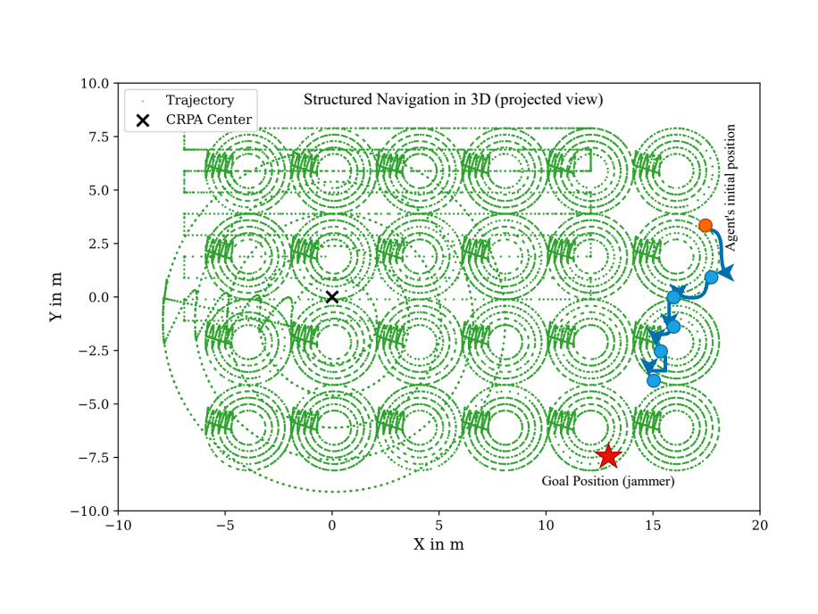
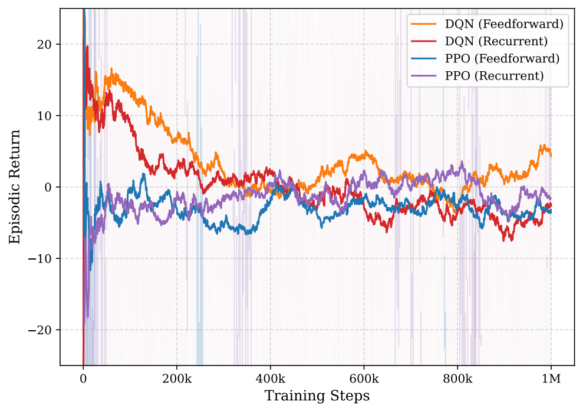

# Reinforcement Learning for Adaptive GNSS Interference Monitoring

**Master's thesis portfolio | Mohammad Shamail Jamal Khan | FAU Erlangen-Nuremberg**

Research into active GNSS interference-source localization: an agent uses RF observations to choose where to move, learns from sequential measurements, and attempts to adapt when the environment changes.

**Research period:** July 2025 - January 2026. **Submitted:** January 28, 2026. **Public portfolio prepared:** October 26, 2026. **Published:** October 27, 2026.

## Project at a glance

| Research question | Approach |
| --- | --- |
| How can RF observations guide active jammer localization? | Formulate navigation as a sequential decision problem with Gymnasium environments. |
| Can memory help with ambiguous measurements? | Compare feedforward DQN/PPO against recurrent policies using LSTM representations. |
| Can a policy adapt to a different environment? | Explore heads-only ANIL-style first-order MAML adaptation across wall configurations. |

**Technologies represented:** Python, PyTorch, Gymnasium, NumPy, scikit-learn, TensorBoard, and recurrent neural networks.

## Start here

- [Technical walkthrough](docs/TECHNICAL_WALKTHROUGH.md): environments, learning methods, and source entry points.
- [Reported results](docs/RESULTS.md): selected findings, including low success rates and transfer limitations.
- [Reproducibility](docs/REPRODUCIBILITY.md): missing materials and checks actually performed.
- [Publication notes](docs/PUBLICATION_NOTES.md): provenance and public-release exclusions.

## Approach

RF measurement at agent position -> IQ or spectrogram observation -> feedforward or recurrent policy -> navigation action -> environment transition and reward -> next observation.

The archived code retrieves observations from measurement-backed navigation environments. This is an offline research setup, not a live GNSS receiver integration or a deployed monitoring system.

*Archived thesis illustration of Environment B; a schematic rather than a geographical location.*

## Selected evidence

*Archived experiment figure; training was not rerun for publication.*

The thesis reports modest benefits from temporal memory and environment-dependent adaptation. Successful localization remained rare. On held-out wall configurations, reported success rates ranged from 0% to 7% across the compared methods and checkpoints. These exploratory results do not establish deployment readiness. See [results and context](docs/RESULTS.md).

## Source map

| Location | Contents |
| --- | --- |
| src/agents/ | Eight archived DQN, PPO, recurrent, and first-order meta-learning scripts |
| src/classes/ | Two environments, two registration modules, and two CNN models |
| assets/ | Four rendered thesis experiment figures |
| environment.yml | Archived Linux Conda environment specification |
| docs/ | Methods, reported results, reproducibility, and provenance |

## Running and validation

**This is a code-and-results portfolio, not a turnkey training package.** RF datasets, the dataset loader, some original package modules, and evaluation scripts are not included. Imports require restoration and authorized data before training can run. The archived Linux environment export has not been installed or validated for this release.

All 14 published Python files passed syntax parsing during preparation. This does not establish runtime correctness: no training, inference, or result reproduction was performed. Read the [reproducibility notes](docs/REPRODUCIBILITY.md) before attempting execution.

## History and attribution

This public repository is a curated snapshot of a completed thesis submission, prepared on October 26, 2026. Its commits record publication and subsequent maintenance, not the original research timeline. A separate archive used disclosed, retrospectively reconstructed June-August 2026 organizational dates; those commits are not imported here and are not evidence of original development activity.

Agent implementations include adaptations of CleanRL patterns. This project does not claim to originate DQN, PPO, LSTM, MAML, or their upstream implementations. See [third-party notices](THIRD_PARTY_NOTICES.md). No new blanket license is assigned to the thesis author's material; upstream licenses continue to apply to upstream portions.
