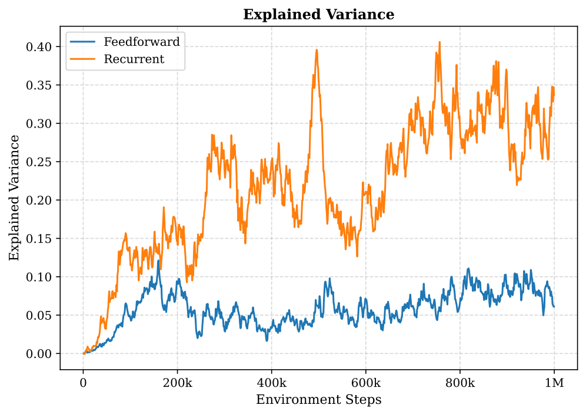
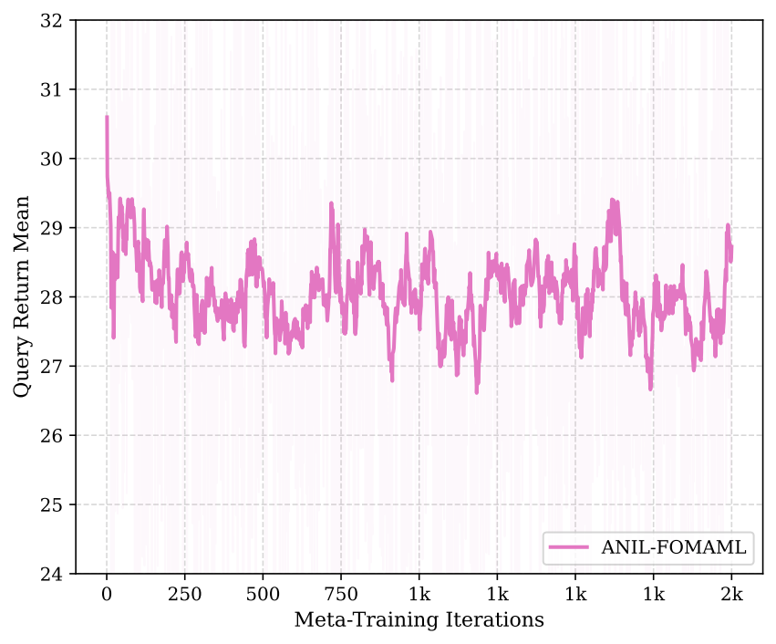

# Reported thesis results

The table is transcribed from the submitted thesis, Section 6.3 and Table 6.3 (printed pages 61-64; PDF pages 83-86). It has not been independently reproduced. The complete thesis is retained privately because it includes personal details and institutional material.

## Held-out environment adaptation

The recurrent PPO baseline was jointly trained and evaluated zero-shot. FOMAML was evaluated after adaptation at two meta-training checkpoints. The thesis describes 100 evaluation episodes for the recurrent baseline; missing evaluation scripts prevent verification of the complete evaluation protocol.

| Method | Held-out wall | Success rate (%) | Mean localization error (m) | Mean return |
| --- | --- | ---: | ---: | ---: |
| Recurrent PPO | 3 | 1.0 | 4.37 | -2.62 |
| Recurrent PPO | 4 | 4.0 | 4.19 | -1.85 |
| FOMAML, 1,400 iterations | 3 | 0.0 | 4.41 | -3.05 |
| FOMAML, 1,400 iterations | 4 | 7.0 | 4.03 | -0.33 |
| FOMAML, 2,000 iterations | 3 | 4.0 | 4.18 | -0.98 |
| FOMAML, 2,000 iterations | 4 | 2.0 | 4.28 | -2.75 |

Adaptation improved some wall/checkpoint combinations and worsened others. The study does not establish consistent superiority, statistical significance, or robust real-world localization.

## Training diagnostics

Value-function explained variance is a diagnostic, not a localization accuracy metric.

Higher meta-training query returns did not imply reliable held-out adaptation. The thesis reports checkpoint sensitivity and inconsistent transfer.

## Limits of the evidence

- Successful episodes remained rare and localization errors remained substantial.
- Original datasets and some code modules are missing.
- The table and figures are archived evidence, not newly measured results.
- No new confidence intervals, additional seeds, or statistical comparisons were produced for this release.

## Figure provenance

The four PNGs in assets/ are rendered from supplied thesis plots: figure_environmentB1.drawio.pdf, training_return_comparison2.pdf, explained_variance_comparison.pdf, and meta_learning_results.pdf. Original plotted data and labels are retained. Source PDFs and their metadata are not distributed here.
